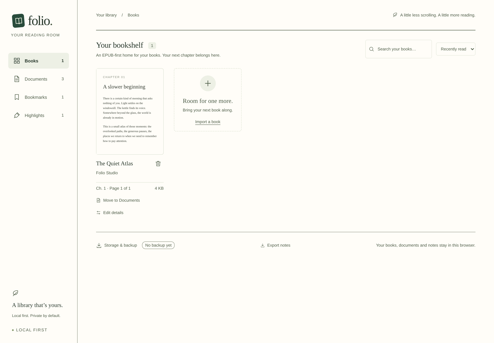
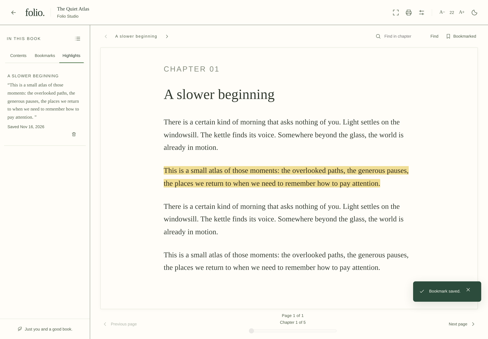

<div align="center">

# Folio

**Your books. Your notes. Your reading room.**

A private library and reader for Chrome. Read **EPUB and MOBI** books and keep **PDF, DjVu and Markdown** documents beside them, with bookmarks, highlights and backups. Everything stays in your browser: no account, no ads, no tracking.


[](https://github.com/captainprice24/EPUBchrome/actions/workflows/ci.yml)

[**Install from the Chrome Web Store**](https://chromewebstore.google.com/detail/ledggmakmbckalemicbpioibgiakheop) · [Try it in the browser](https://captainprice24.github.io/EPUBchrome/) · [User guide](docs/INSTALLATION.md) · [Privacy](docs/PRIVACY.md)

</div>



## Install

Install Folio from the [Chrome Web Store](https://chromewebstore.google.com/detail/ledggmakmbckalemicbpioibgiakheop). It opens in a tab after installation; later, click its toolbar icon. Choose **Import a book**, drop one or several files into the window, or open the included sample.

To try it without installing, use the [web version](https://captainprice24.github.io/EPUBchrome/). It keeps its own library in that browser, separate from the extension.

## Features

| Area | What you get |
| --- | --- |
| Library | Separate Books and Documents shelves, covers or first-page previews, search, sorting by title, author or date, editable title and author, import of several files at once |
| Reading | Horizontal pages or vertical scrolling, one or two pages in wide windows, text size, typeface, spacing, margins, Paper, Sepia and Night pages, fullscreen |
| Finding your place | Contents, publisher page lists, page counts per chapter, a saved place that survives changes of text size and window, find in chapter with next and previous |
| Bookmarks and highlights | Anchored to the passage, listed in reading order, exportable as Markdown or JSON |
| PDF and DjVu | Original pages with zoom, text selection where the file has text, PDF outlines and links |
| Backup | One `.folio` file with originals, places and notes; restore merges into an existing library; a reminder when new items are not yet backed up |
| Printing | A chapter or a whole reflowing book through Chrome's **Save as PDF**; PDFs download unchanged |



Limits: DRM-protected books and password-protected PDFs do not open. Fixed-layout EPUB is shown as reflowing text. Size ceilings are 1 GB for EPUB, PDF and DjVu, 64 MB for MOBI and 16 MB for Markdown. See [formats and limits](docs/FORMATS.md).

## Privacy and your files

- Originals are never modified. Notes and reading positions are stored separately.
- Nothing is uploaded. There is no analytics or telemetry, and the store build requests one permission, `unlimitedStorage`.
- Scripts, forms, frames and online resources inside books are blocked.
- **The library lives in this browser profile.** Uninstalling Folio or clearing browser data deletes it. Keep your original files and use **Storage & backup**.

Details: [privacy and local data](docs/PRIVACY.md) and the [published privacy policy](https://captainprice24.github.io/EPUBchrome/privacy.html).

## Build from source

You need Node.js 22 or later and npm. Python 3 is needed only to run the browser tests.

```sh
git clone https://github.com/captainprice24/EPUBchrome.git
cd EPUBchrome
npm ci
npm run build
```

Then open `chrome://extensions`, turn on **Developer mode**, choose **Load unpacked** and select `.output/chrome-mv3`.

```sh
npm run dev          # development browser with reload
npm run lint         # static checks
npm run typecheck    # strict TypeScript
npm run test:unit    # unit tests
npm test             # browser tests (needs Chromium and python3)
npm run test:extension  # the built extension, loaded in Chromium
npm run package      # .output/folio-<version>-chrome.zip
```

See [CONTRIBUTING.md](CONTRIBUTING.md) for the test setup and source layout.

## Documentation

| Guide | Contents |
| --- | --- |
| [User guide](docs/INSTALLATION.md) | Reading, notes, printing, backup, troubleshooting |
| [Formats and limits](docs/FORMATS.md) | What each format supports |
| [Privacy and local data](docs/PRIVACY.md) | Storage, permissions, document isolation |
| [Storage and upgrades](docs/STORAGE.md) | Database layout, migration, recovery |
| [Validation](docs/VALIDATION.md) | What the automated checks cover and what they do not |
| [Assessment](docs/ASSESSMENT.md) | Review of v0.5.1, what v0.6 fixed and what remains open |
| [Google Drive setup](docs/GOOGLE_DRIVE.md) | Optional import for self-built copies; not in the store build |
| [Web version](docs/GITHUB_PAGES.md) and [store submission](docs/CHROME_WEB_STORE.md) | Deployment and release notes for maintainers |
| [Security](SECURITY.md) | How to report a vulnerability |
| [Development history](docs/history/README.md) | Earlier audits, responses and research |

Built with TypeScript, React, WXT, zip.js, Dexie, PDF.js and a Rust/WebAssembly DjVu decoder. Dependency licences are listed in [THIRD_PARTY_NOTICES.md](THIRD_PARTY_NOTICES.md). A licence for this project's own source code has not been chosen yet.
