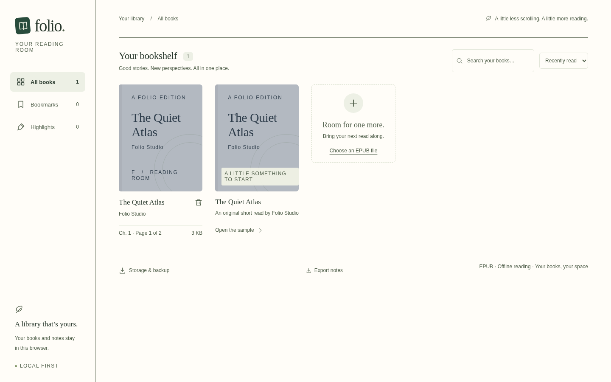
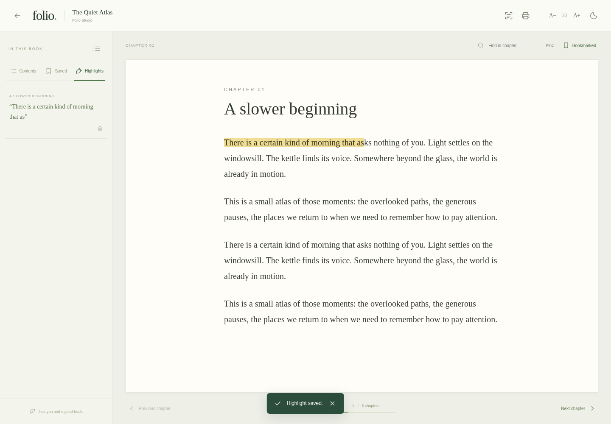
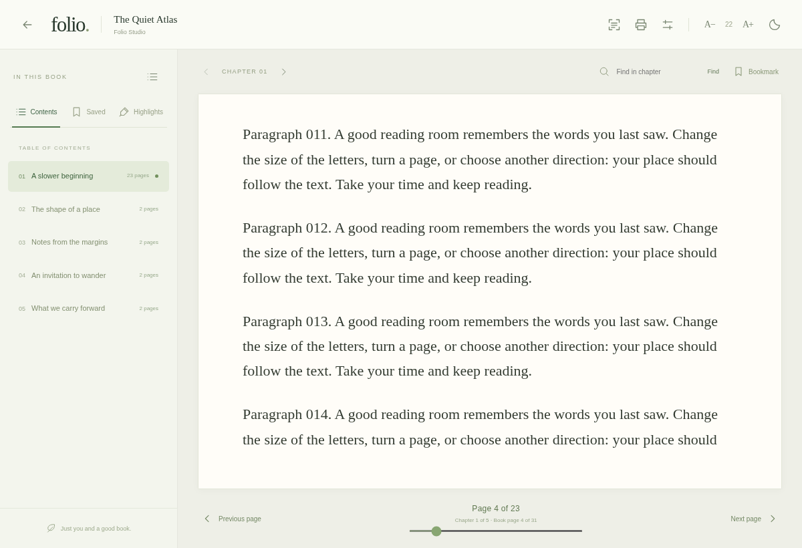
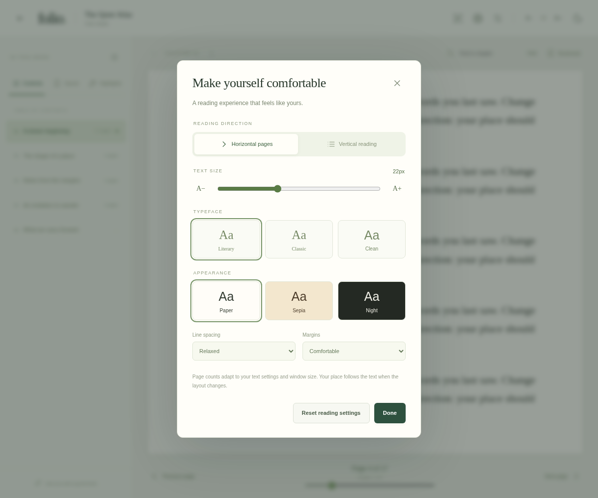
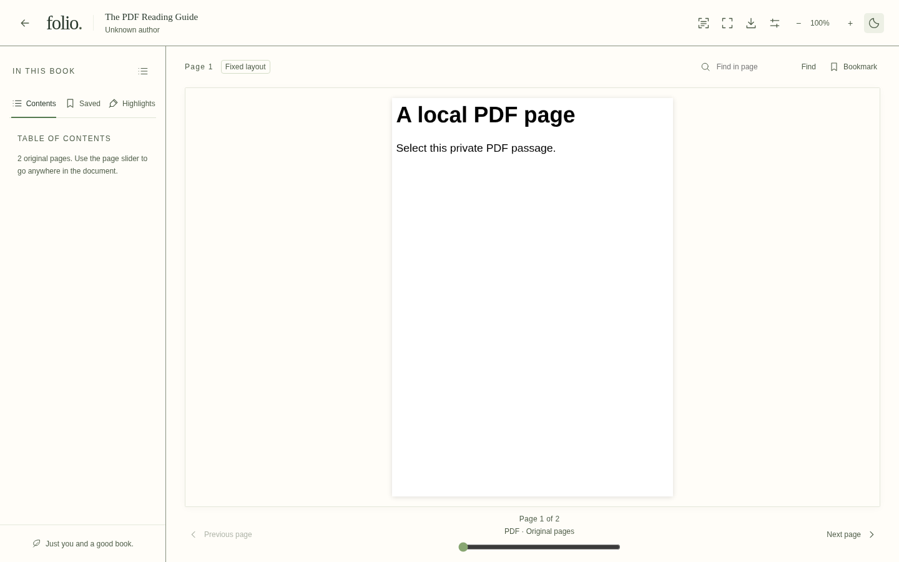
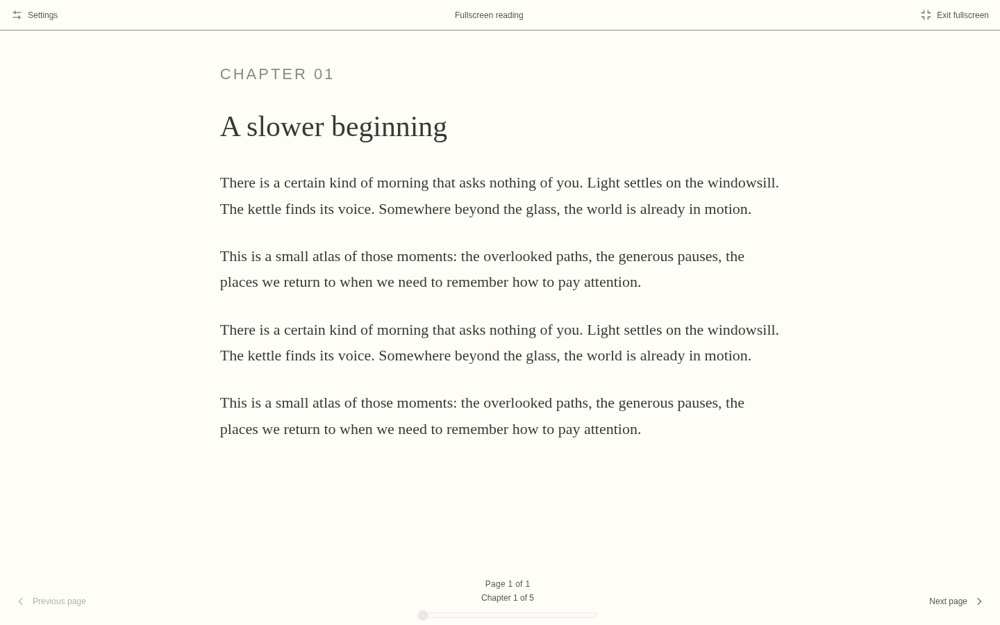

<div align="center">

# Folio · EPUBchrome

**Your books. Your notes. Your reading room.**

A private Chrome reader for **EPUB, PDF, DjVu, MOBI and Markdown**, with fullscreen reading, bookmarks, highlights and offline OCR.


[](https://github.com/captainprice24/EPUBchrome/actions/workflows/ci.yml)

[Web preview](https://captainprice24.github.io/EPUBchrome/) · [Get started](#get-started) · [Features](#features) · [Google Drive](docs/GOOGLE_DRIVE.md) · [Contribute](CONTRIBUTING.md) · [Research](docs/RESEARCH.md)

</div>



## Read at your own pace

Bring in a DRM-free EPUB, PDF, DjVu, MOBI or Markdown file from your computer, read page by page in either direction, and save bookmarks and highlights. Your library and notes live in your browser. The included **The Quiet Atlas** sample is an original short read, so you can try Folio immediately.



### Pages that follow your reading

Turn pages horizontally or read vertically, see the page count in each chapter, and return to your saved passage. Text size, typeface, spacing, margins and window size recalculate the layout without discarding your place.



<details>
<summary>Reading preferences: direction, text, spacing and themes</summary>



</details>

## Features

| Feature | Available in v0.4 |
| --- | --- |
| Local document library | File picker, drag and drop, title/author search, sorting and removal |
| Chapter navigation | EPUB 3 contents, nested EPUB 2 NCX, spine order and publisher page lists when supplied |
| Pages and reading tools | Per-chapter layout counts for reflowing books; original page counts for PDF/DjVu, page slider, saved place and text search |
| Fullscreen | Toolbar button or **F**, distraction-free fallback, **Esc**/visible exit, preserved passage |
| Reading preferences | Reflowable text size, Publisher/three reader typefaces, themes, spacing and margins; zoom for original PDF/DjVu pages |
| Bookmarks and highlights | Verified text-quote anchors, navigation and JSON notes export/import |
| Backup and restore | Original books, positions, annotations and OCR in a local `.folio` archive |
| On-device OCR | Printed English in chapter images; bundled worker, WASM and model; text download |
| PDF and DjVu | On-demand original pages, zoom, embedded text selection where available, PDF outlines/internal links; lossless original PDF download |
| PDF printing | Reflowing chapter/book through Chrome’s **Save as PDF**; current-page raster printing for DjVu |
| Google Drive | File-link import after configuring a Google OAuth client; live-account validation pending |

**This is an early development build.** Handwriting recognition, accurate native fixed-layout EPUB rendering, automated PDF conversion and verified very-large-book performance are still future work. Input ceilings are safety limits, not performance guarantees: 1 GB for EPUB/PDF/DjVu, 64 MB for MOBI and 16 MB for Markdown. Password-protected PDF and DRM-protected MOBI are not supported. See [current limits](docs/INSTALLATION.md#current-limits) and [validation coverage](docs/VALIDATION.md).

## Try the web preview

The GitHub Pages test site is configured for **https://captainprice24.github.io/EPUBchrome/**. Deployment runs after successful checks on `main`; check the [Actions tab](https://github.com/captainprice24/EPUBchrome/actions/workflows/ci.yml) for its status.

Try the sample or import a supported local document to test reading, bookmarks, highlights, local printed-English OCR and PDF printing without installing the extension. The preview also provides a Chrome extension ZIP. Google Drive sign-in requires the configured extension, and the web preview has separate local storage. See [Pages deployment and testing](docs/GITHUB_PAGES.md).

## Get started

You need **Node.js 24.x**, npm, Git, Python 3 (`python3`) and `curl` on your development machine. On Windows, use WSL for the build commands; the resulting extension can be loaded in Windows Chrome.

```sh
git clone https://github.com/captainprice24/EPUBchrome.git
cd EPUBchrome
npm ci
npm run build
```

Installation downloads approximately 11 MB of English OCR model data, verifies its pinned SHA-256 digest, and packages the OCR code locally. After building, local reading and OCR do not need a network connection.

1. Open `chrome://extensions` in Chrome.
2. Turn on **Developer mode**, then choose **Load unpacked**.
3. Select the `.output/chrome-mv3` folder inside the project.
4. Pin **Folio** and click its toolbar icon.
5. Choose **Import a book**, drop a supported document into the app, or open the included sample.

The app itself does not require a server, a Google account or an OCR subscription for local files.

### Make a portable build

```sh
npm run package
```

This creates `.output/folio-0.4.0-chrome.zip`. Unzip it and load the extracted folder as above. The GitHub **Code → Download ZIP** option downloads source code, which must be built first; it is not an installable extension. This project has not been published to the Chrome Web Store.

### Develop and test

```sh
npm run dev          # WXT development browser
npm run typecheck    # Strict TypeScript checks
npm run build        # Production Chrome MV3 build
npm test             # Reader, OCR and pagination integration tests
```

Browser tests require Chromium. Set `CHROMIUM_PATH` to its executable, or follow the [test setup instructions](CONTRIBUTING.md#browser-tests). GitHub Actions builds and tests the app and is configured to upload an extension ZIP after successful checks; workflow results appear in the **Actions** tab.

## Google Drive

Drive import is optional. It needs a public OAuth client ID associated with the extension’s stable ID, a consent screen and an enabled Drive API. No OAuth client secret belongs in the extension.

Follow the [Google Drive configuration guide](docs/GOOGLE_DRIVE.md). The current implementation requests read-only Drive access and has not yet been tested with a live configured account.

## Privacy and document safety

- Original documents are never rewritten; annotations and OCR results are stored separately.
- Local reading and OCR run in your browser. No analytics or telemetry are included.
- Imported scripts, forms, frames and external resource URLs are blocked.
- Browser data removal or uninstalling Folio can delete the local library. Keep your originals and download library backups.

See the [privacy guide](docs/PRIVACY.md) for storage, permissions and data-loss considerations.

## Project guide

| Guide | Contents |
| --- | --- |
| [Installation and troubleshooting](docs/INSTALLATION.md) | Loading the extension, printing, OCR, packaging and supported limits |
| [Google Drive setup](docs/GOOGLE_DRIVE.md) | OAuth configuration, extension identity and permissions |
| [Contributing](CONTRIBUTING.md) | Development commands, testing and source layout |
| [Validation](docs/VALIDATION.md) | What was tested and what remains unverified |
| [Engineering research](docs/RESEARCH.md) | Reader, OCR and PDF references; language decisions; REA investigation plan |
| [Third-party notices](THIRD_PARTY_NOTICES.md) | Dependency attribution and OCR model provenance |

Built with **TypeScript, React, WXT, zip.js, Dexie and Tesseract.js**. Rust/WASM modules and a Python OCR backend are research options; neither is required by the app. A project source-code license has not been selected; third-party components retain their own licenses.

## Audit and reliability work

The [independent v0.2 audit](docs/AUDIT.md) and [v0.3 response](docs/AUDIT_RESPONSE.md) record verified defects, fixes, deferred work and recommendations we did not adopt. Version 0.3 corrects XHTML and linked/imported styles, supports supplementary content links and RTL page movement, verifies saved passages, adds backup/restore and improves UI legibility. Three pinned IDPF/W3C samples and axe checks supplement the existing reader tests. This is not a conformance or accessibility certification.

## More formats, the same private library

Markdown and MOBI use the reflowing reader, including chapters, typography, highlights and PDF printing. PDF and DjVu retain their original page layout; use the original-page slider, **Zoom in/out**, and **Fit page**. Enter fullscreen using the toolbar or **F** and exit with **Esc** or **Exit fullscreen**. Browsers without the fullscreen API use a view that fills the current tab.

[Format support and limits](docs/FORMATS.md) explains encrypted files, Markdown images, MOBI variants, DjVu text layers, backup compatibility and what has actually been tested.




